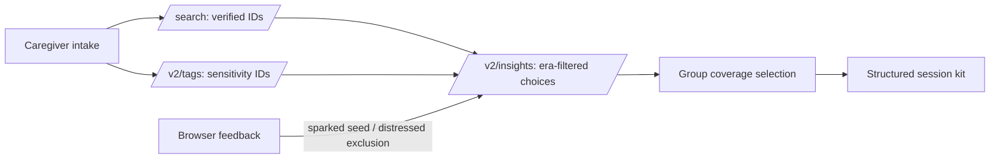

# Echoes

Echoes is a Qloo-powered reminiscence-session kit generator for memory-care activity staff and family caregivers. It turns a few familiar favorites into a considerate 30-minute activity-support session. It is not medical advice, diagnosis, or treatment.

Every visible cultural choice is resolved to a Qloo entity ID before it renders. If Echoes cannot verify it, it drops it rather than guessing.

## Run locally

```sh
npm install
cp .env.example .env.local
npm run dev
```

Set this server-only variable in `.env.local`:

```env
QLOO_API_KEY=your_key
QLOO_BASE_URL=https://hackathon.api.qloo.com
TMDB_API_KEY=your_tmdb_key
# Optional, used only for structured intake and staff-review note prose
GROQ_API_KEY=your_groq_key
```

Open `http://localhost:3000`. The app includes three demo profiles (Ghana, Japan, and Spain). Use a deployed environment variable for the hosted demo; never use a `NEXT_PUBLIC_` prefix for the Qloo key.

## How Qloo powers Echoes

1. `/search` resolves each loved thing to a Qloo entity ID. Unresolved inputs are dropped.
2. `/v2/tags` resolves optional sensitivities into valid exclusion tags.
3. `/v2/insights` expands and ranks candidate music, films, TV, books, and places from the ages 13–25 reminiscence window, with demographic, location, familiarity, safety, and exclusion inputs.
4. Each displayed artist is independently checked against a MusicBrainz release year; each displayed film/TV item is independently checked against TMDB. An item without an evidence year in at least one matched resident's window is dropped.
5. For groups, Echoes re-scores the shared candidate pool per person, then selects a compact set that maximizes coverage.
6. “Sparked response” feedback becomes a future seed and “not for us” becomes a browser-persisted resident-specific exclusion. Only a nickname, entity ID, and feedback state live in the browser; Echoes stores no profile on its server.

## Workspace and live sessions

Each browser receives a secret-link workspace fragment. It persists nicknames, kits, feedback, and agent traces across reloads in that browser; **it is not a shared or cross-device database**. The footer’s delete-everything action clears every Echoes workspace from that browser.

The live mode is deliberately low-tap: one item at a time, sparked/neutral/not-for-us responses, a three-point observed-engagement/pleasant-moments check, and a “Draft for staff review” note. Echoes is activity support for connection and pleasant moments, not medical advice or treatment; follow the person’s care plan.



## Architecture

- `lib/echoes/qloo.ts` — typed, fixed-host Qloo client with timeouts, retries, caching, request de-duplication, and structured errors.
- `lib/echoes/pipeline.ts` — verified-only pipeline, era requests, group selection, and caregiver-safe structured kit.
- `app/api/echoes/kit/route.ts` — rate-limited same-origin server orchestration; Qloo credentials never leave the server.
- `components/echoes/echoes-app.tsx` — intake, kit view, feedback, and printable About Me sheet.
- `app/eval/page.tsx` — measurable grounding and coverage evaluation against non-US demo profiles.

## Verification

```sh
npm run qloo:smoke
npm test
npm run typecheck
npm run lint
npm run build
```

`qloo:smoke` checks the live hackathon host and records accepted parameters in [docs/qloo-notes.md](docs/qloo-notes.md). The tests cover era-window math, group coverage selection, resident-specific exclusion persistence, and dropping unresolved entities.

## License

[MIT](LICENSE)
